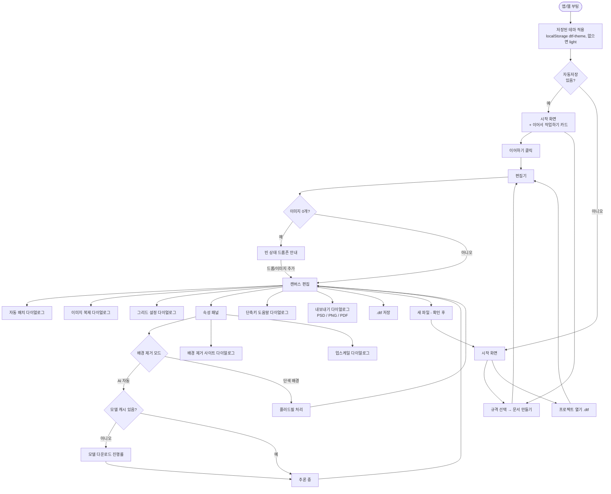

# 화면 흐름도 및 와이어프레임

- **문서 목적**: v0.5.0의 화면 구조·버튼 배치·테마 토큰을 한 장에서 확정해 디자이너·구현자가 같은 그림을 보게 한다.
- **대상 독자**: 디자이너, 프런트엔드 엔지니어, QA
- **최종 수정일**: 2026-11-23 (v0.5.0)

> 구조: `src/renderer/src/App.tsx`가 `doc === null`이면 전체 화면 시작 화면, 아니면 `ProxyCanvas`(상단 2행 바 + 캔버스 + 속성 패널 + 하단 상태 바). 아래는 v0.5.0 구현 결과를 코드(JSX)와 대조해 그린 구조도이며, 문구는 구조 설명용이고 실제 문구는 컴포넌트 소스가 기준이다.

---

## 1. 화면 흐름도



자동저장은 편집기 어디서든 백그라운드로 1.5초 디바운스 기록(`web/src/api/autosave.ts`) — 흐름도에는 화면 전환이 없어 생략.

---

## 2. 시작 화면

### 2.1 데스크톱 폭 (≥ 1024px, `lg`)

```
┌──────────────────────────────────────────────────────────────────────────────┐
│ ◧ DTF GangSheet Studio                                   [☀ 밝게 | 🌙 어둡게]  │
├────────────────────────────────────────┬─────────────────────────────────────┤
│ [350 DPI · 인쇄소 납품 규격]            │ ┌─────────────────────────────────┐ │
│ 여러 디자인을 한 장에,                  │ │ ⟲ 이어서 작업하기             →  │ │ ← 자동저장 있을 때만
│ 갱시트를 쉽고 빠르게                    │ │   3분 전 자동 저장 · 이미지 12개 │ │
│ 설명 문단(회원가입 없이 바로 시작)       │ │   · 50 × 100 cm                  │ │
│                                        │ └─────────────────────────────────┘ │
│ ┌────────────────────────────────┐     │ ┌─────────────────────────────────┐ │
│ │ 대표 이미지(hero.webp 1200×900)│     │ │ 새 문서 만들기                  │ │
│ │ Canva 제작, 번들 에셋          │     │ │ [롤(갱시트)] [A4] [A3]          │ │
│ └────────────────────────────────┘     │ │ 가로 폭 [30][50][60][100] [▾ cm]│ │
│                                        │ │ 세로 길이 ( )1 m  ( )2 m        │ │
│ ① 규격 고르기                          │ │ 만들 문서 50×100cm · px · 350DPI │ │
│ ② 이미지 올리기                        │ │ [        문서 만들기  →       ] │ │
│ ③ 내보내기                             │ │ [ 📂 프로젝트 열기 (.dtf)     ] │ │
│                                        │ └─────────────────────────────────┘ │
│                                        │ 🛡 이미지는 서버로 전송되지 않고 …   │
└────────────────────────────────────────┴─────────────────────────────────────┘
```

- "이어서 작업하기" 카드는 `window.api.getResumableSession()`이 값을 줄 때만 표시하며 [새 문서 만들기] 카드 **위**(우측 열 맨 위)에 있고 강조 테두리(indigo)다. 클릭하면 `openProject(path)`로 복원. 저장 시각은 상대 표기(방금 전/N분/N시간/N일 전). 카드에 삭제 버튼은 없다.
- 프리셋 카드는 선택 상태에 indigo 테두리. A4/A3 선택 시 가로 폭·세로 길이 영역은 숨기고 요약(cm·px)만 표시(`fixedPreset`).
- 1024px 미만: 히어로 → 우측 열(이어하기 카드 → 새 문서 카드) 순으로 1열.
- 하단 안내 문구 "이미지는 서버로 전송되지 않고 내 컴퓨터 안에서만 처리됩니다."는 정적 문구다. AI 배경 제거는 모델 가중치를 내려받는 외부 요청이 있지만 문구에는 반영되어 있지 않다.

### 2.2 시선·배치 근거

- **F자 시선**: 좌상단 제목 → 대표 이미지 → 3단계(이해) → 우측 카드(행동). 읽는 순서와 행동 순서를 일치.
- 기본 버튼 [문서 만들기]는 카드 하단 전폭 버튼이고, 보조 [프로젝트 열기]는 그 아래 윤곽선 버튼.
- 테마 전환은 시작 화면 우상단 헤더와 편집기 상단 바 우측에 있다(시작 화면은 "밝게/어둡게" 두 칸, 편집기는 아이콘 한 개).

---

## 3. 편집기

### 3.1 전체 레이아웃

```
┌─────────────────────────────────────────────────────────────────────────────────────────────┐
│ ◧ 문서명 .dtf │ 새 파일 열기 저장 │ 실행취소 다시실행 │ ········· │ 단축키 │ ☾ │ [내보내기] │ ← 1행 56px
├─────────────────────────────────────────────────────────────────────────────────────────────┤
│ [＋ 이미지 추가] │ 배치 [자동 배치][이미지 복제][채우기][안에 맞춤] │ 보기 [그리드][투명 배경 표시][여백 자동 제거] │ ← 2행 48px
├─────────────────────────────────────────────────────────────────────────┬───────────────────┤
│ ┌ 자(ruler) ───────────────────────────────────────────────────────┐    │ 속성       12개   │
│ │                 ┌──────────────── 문서 ───────────────┐          │    │ ───────────────── │
│ │                 │      (캔버스: Konva, 줌/팬)          │          │    │ 위치 / 크기        │
│ │                 │   (이미지 0개면 중앙 빈 상태 안내)    │          │    │ 문서 기준 정렬      │
│ │                 └──────────────────────────────────────┘          │    │ 레이어 순서        │
│ └───────────────────────────────────────────────────────────────────┘    │ 배경 제거          │
│                                                                           │ (AI 자동|단색 배경)│
│                                                                           │ 업스케일 · 이미지 복제│
├─────────────────────────────────────────────────────────────────────────┴───────────────────┤
│ 50 × 100 cm │ 6,890×13,780 px │ 이미지 12개 │ 휠·Space·우클릭 힌트 │ 방향키 이동 [−] 5 mm [+] │ 35% [화면 맞춤] │ ← 40px
└─────────────────────────────────────────────────────────────────────────────────────────────┘
```

### 3.2 상단 바 그룹과 버튼

| 행 | 그룹 | 버튼(실제 라벨) | 비고 |
|---|---|---|---|
| 1 | 로고·문서명 | 로고 아이콘, 문서명(파일명 또는 "제목 없음") + ".dtf" | 문서명은 말줄임(`truncate`), 툴팁에 전체 |
| 1 | 파일 | 새 파일 / 열기 / 저장(Ctrl+S) | 새 파일은 미저장 경고 `window.confirm` 유지 |
| 1 | 실행 | 실행취소 / 다시실행 | 불가하면 비활성 |
| 1 | 우측 | 단축키 / 테마 토글 / **내보내기(기본 강조)** | 내보내기는 이미지 0개면 비활성 |
| 2 | 이미지 추가 | **이미지 추가(강조 윤곽)** | 파일 선택 |
| 2 | 배치 | 자동 배치 / 이미지 복제 / 채우기 / 안에 맞춤 | 자동 배치는 이미지 0개면 비활성, 나머지 셋은 선택 필요(없거나 잠금이면 비활성) |
| 2 | 보기 | 그리드 / 투명 배경 표시 / 여백 자동 제거 | 토글은 켜짐을 배경색으로 표시(`aria-pressed`) |

- **시선·배치 근거**: 1행은 문서·파일·되돌리기(좌)와 보조·최종 행동(우), 2행은 이미지를 넣고 배치하고 보는 작업 순서. 기본 강조(채움) 버튼은 **내보내기** 하나이고 이미지 추가는 윤곽 강조.
- 각 버튼은 아이콘 + 텍스트 라벨이 항상 보인다(폭이 좁을 때 라벨을 줄이거나 드롭다운으로 접는 동작은 없고, 각 행이 `overflow-x-auto`로 가로 스크롤). 화면 맞춤은 하단 상태 바에 있다.
- 모든 버튼의 `aria-label`은 `title` 값(`OverlayButton`)이다.

### 3.3 하단 상태 바

| 영역 | 내용 |
|---|---|
| 문서 | `W × H cm`, md 이상에서 `W × H px` 병기 |
| 항목 수 | `이미지 N개` |
| 조작 힌트 | lg 이상에서만 한 줄: 휠 확대·축소 · Space+드래그 화면 이동 · 우클릭 정렬·잠금 메뉴 |
| 이동 스텝 | `−` `N mm` `+` (1~50mm, 기본 5) |
| 배율 | `NN%` 표시, [화면 맞춤] |

높이 40px 한 줄. 줌 −/+ 버튼과 "N개 선택" 표기는 없다(줌은 마우스 휠, 선택 수는 속성 패널에 표시). 계획했던 "맥락 힌트"는 위 정적 힌트 한 줄로 대체됐다.

### 3.4 빈 상태 (이미지 0개)

```
┌──────────────── 캔버스 ─────────────────┐
│          ┌ ─ ─ ─ ─ ─ ─ ─ ─ ─ ─ ┐         │
│          │     🖼 (아이콘)        │         │
│          │ 이미지를 여기에 끌어다 놓으세요 │ │
│          │ 여러 장을 한꺼번에 올릴 수 있어요│ │
│          │ 올린 뒤 자동 배치를 누르면 …   │ │
│          │    [ 이미지 선택 ]          │ │
│          │ PNG · JPG · WebP · PSD       │ │
│          └ ─ ─ ─ ─ ─ ─ ─ ─ ─ ─ ┘         │
└──────────────────────────────────────────┘
```

- 문서 사각형이 아니라 **뷰포트 중앙**에 표시, 컨테이너는 `pointer-events: none`(캔버스 팬/줌 방해 없음)이고 [이미지 선택] 박스만 클릭 가능. `images.length === 0`일 때만 렌더.
- 파일 선택 필터는 `.png,.jpg,.jpeg,.webp,.bmp,.tif,.tiff,.psd`(`fsAccess.ts IMAGE_EXTENSIONS`)이고 안내 문구는 "PNG · JPG · WebP · PSD"만 적는다. 드래그 오버 하이라이트는 구현하지 않았다.

### 3.5 속성 패널

- 폭 `w-80`(320px). 상단에 "속성" 제목, 선택 파일명(또는 "N개 다중 선택"/"선택 없음"), 항목 수 배지.
- 단일 선택 섹션(위→아래): 위치 / 크기 → 문서 기준 정렬 → 레이어 순서 → **배경 제거** → 업스케일 → 이미지 복제.
- 다중 선택: 정렬 → 레이어 순서 → 배경 제거(선택 N개 일괄, 설명에 "전체를 Ctrl+Z 한 번으로" 안내).
- 선택 없음: "선택된 항목 없음" + [다른 배경 제거 사이트 보기].
- 배경 제거 섹션: 모드 라디오(`BgModePicker`, 웹에서만) — "AI 자동"(보조 "사진 · 일러스트") / "단색 배경"(보조 "로고 · 글자"), 모드별 설명 문단, 실행 버튼(진행 중에는 단계 라벨), [다른 배경 제거 사이트 보기]. 데스크톱은 모드 선택 없이 rembg 단일 방식 설명을 보인다.
- AI 설명 문단의 모델 크기는 "약 85MB"로 적혀 있으나 실제 내려받는 크기는 WebGPU 약 84MB, WASM 폴백이면 약 168MB다.

---

## 4. 주요 다이얼로그

공통 규칙: 중앙 모달, `Esc` 닫기, 바깥 클릭 닫기(진행 중 작업이 있는 다이얼로그 제외), 기본 버튼 우하단, 취소 좌측. 모달 열림 중 캔버스 단축키는 비활성(`ProxyCanvas` 키 핸들러가 이미 `gridOpen||…||exportOpen||nestingOpen||upscaleTarget` 중에 return).

### 4.1 내보내기 (`ExportDialog.tsx`)

```
┌ 내보내기 ──────────────────────────────────┐
│ 형식                                         │
│ (•) PSD   RGB · 350 DPI   (웹)               │
│            CMYK · 350 DPI (데스크톱)          │
│ ( ) PNG   알파 보존 · 350 DPI                 │
│ ( ) PDF   검수용 · 흰 배경                    │
│                                              │
│ [✓] 레이어 병합 (PSD만)                       │
│                                              │
│ 문서 50×100cm · 6,890×13,780px                │
│                                              │
│            [취소]            [내보내기]       │
└──────────────────────────────────────────────┘
진행 중: ▓▓▓▓▓░░░░░ 항목 렌더 7/12 → 파일 저장 [취소]
```

### 4.2 자동 배치 (`NestingDialog.tsx`)

```
┌ 자동 배치 ──────────────────────────────────┐
│ 이미지 간격 [ 2.0 ] cm      [✓] 90° 회전 허용 │
│ ───── 미리보기(실시간 packImages 재계산) ───── │
│ 사용 높이 38.2 cm · 효율 71.3 %               │
│ ✕ 배치 못한 이미지 2개 (빨강)                  │
│                [취소]            [배치하기]    │
└──────────────────────────────────────────────┘
```
간격 기본 2.0cm, 범위 0~50cm. 효율·사용 높이·미배치는 `packImages` 결과(`01` §6).

### 4.3 이미지 복제 (`GridDialog.tsx`)

```
┌ 이미지 복제 ────────────────────────────────┐
│ 행 [ 2 ]  열 [ 2 ]  간격 [ 1 ] cm            │
│ [가로 채우기] [세로 채우기] [전체 채우기]      │
│ 총 4개 · 결과 크기 W × H cm                   │
│ ⚠ 가로가 롤 폭을 넘어요                       │
│                [취소]            [복제]       │
└──────────────────────────────────────────────┘
```
행·열 1~50, 간격 0~50cm(`01` §4.6).

### 4.4 그리드 설정 (`GridSettingsDialog.tsx`)

```
┌ 그리드 설정 ────────────────────────────────┐
│ [✓] 그리드 표시                               │
│ 간격 [ 5 ] cm (0.5 ~ 50)                      │
│ 색   ● ● ● ● ● ● ● ●  (8개 프리셋)            │
│ 선   (•) 실선  ( ) 대시  ( ) 도트              │
│                              [닫기]           │
└──────────────────────────────────────────────┘
```

### 4.5 업스케일 (`UpscaleDialog.tsx`)

- 입력 단위(cm/px/배율), DPI, 스텝 전략, 맞춤 모드, 출력 형식, 선택 옵션(샤프닝·노이즈 제거는 데스크톱 AI 중심).
- 하단 "예상" 패널: 목표 px, 총 배율, 체인 요약("2배 → 2배"), 경고 코드별 문구, 메모리 추정(`01` §9).
- 웹 안내 문구(`aiUpscale=false`): "웹 버전은 AI 엔진 대신 고품질 단계별 리샘플링으로 확대합니다."

### 4.6 배경 제거 사이트 (`BgSitesDialog.tsx`)

```
┌ 배경 제거 사이트 ───────────────────────────┐
│ 앱의 배경 제거 결과가 아쉬울 때 쓸 무료 사이트   │
│ Canva           [DTF 추천]            ↗      │  ← 맨 위
│ Adobe Express   [DTF 추천]            ↗      │
│ Erase.bg        [DTF 추천]            ↗      │
│ Photoroom                             ↗      │
│ Clipdrop                              ↗      │
│ (안내문) 받은 PNG를 캔버스에 끌어다 놓으세요 …    │
│ [포토샵 클라우드 가이드 (PDF)]                  │
│ [Adobe Express 가이드 (PDF)]                  │
└──────────────────────────────────────────────┘
```
각 항목은 카드 링크: 이름 + 설명 + 외부 링크 아이콘(`target="_blank" rel="noreferrer"`). Remove.bg는 삭제됐다(`caution` 배지 사용처도 없음). 번들 PDF 2종은 `openGuidePdf`/`openBgGuide`로 연다.

### 4.7 단축키 도움말 (`ShortcutsDialog.tsx`)

```
┌ 단축키와 조작법 ───────────────────────── [✕] ┐
│ 화면 보기     마우스 휠 확대·축소               │
│              Space+드래그 / 휠 클릭+드래그 이동 │
│ 선택 · 이동   드래그(자동 맞춤) · Shift+드래그  │
│              빈 곳 드래그 · Ctrl+클릭 · 방향키  │
│ 편집          Ctrl+드래그 복제 · Ctrl+D         │
│              Ctrl+C/X/V · R · Shift+회전 핸들   │
│              Delete                            │
│ 정리 · 저장   Ctrl+G · Ctrl+L · 우클릭 메뉴     │
│              Ctrl+Z/Y · Ctrl+S                 │
└────────────────────────────────────────────────┘
```
2열 그리드(`sm` 이상), 4개 범주. `Esc`·바깥 클릭·[✕]로 닫기. 상단 바 [단축키] 버튼으로만 열고 `?` 키 진입은 없다. 전체 목록의 원본은 `01-core-logic-spec.md` 부록.

### 4.8 배경 제거 진행 표시

별도 오버레이·취소 버튼은 없고, 속성 패널의 실행 버튼이 진행 중 단계 라벨로 바뀐다(`bgStageLabel`): "AI 모델 받는 중 NN%"(첫 사용) → "AI 준비 중…" → "배경 분석 중…" → "경계 다듬는 중…". 일괄 처리는 뒤에 "(n/N)"이 붙는다. 이벤트가 없는 구간(단색 모드)은 "처리 중…". 상세 `04-feedback-ux-plan.md` §3.

---

## 5. 테마 토큰 표

방식(`PRD` F-1): `<html data-theme="light|dark">`. 컴포넌트는 `bg-zinc-950`, `text-zinc-400` 같은 zinc 클래스를 그대로 쓰고, **어두운 팔레트가 Tailwind 기본값(재정의 없음)**이다. 밝은 테마(`:root:not([data-theme='dark'])`)에서만 `src/renderer/src/assets/main.css`가 팔레트 변수를 뒤집어 재정의한다.

| 변수 | 밝은 테마 값 | 어두운 테마 | 주 용도 |
|---|---|---|---|
| `--color-zinc-950` | `#f3f4f7` | Tailwind 기본 | 앱 배경, 패널 바닥 |
| `--color-zinc-900` | `#ffffff` | 〃 | 패널·카드 |
| `--color-zinc-800` | `#e2e5eb` | 〃 | 테두리·호버 |
| `--color-zinc-700` | `#cdd1d9` | 〃 | 강한 테두리, 스크롤바 |
| `--color-zinc-600` | `#98a0ad` | 〃 | 비활성 보조 |
| `--color-zinc-500` | `#646d7c` | 〃 | 보조 글씨 |
| `--color-zinc-400` | `#4a5361` | 〃 | 보조 본문 |
| `--color-zinc-300` | `#353d4a` | 〃 | 본문 |
| `--color-zinc-200` | `#1f2733` | 〃 | 강조 본문 |
| `--color-zinc-100` | `#111827` | 〃 | 제목 |
| `--color-indigo-300` | `#4338ca` | 〃 | 선택·강조 글씨(진하게) |
| `--color-indigo-400` | `#4f46e5` | 〃 | 아이콘·강조 글씨 |
| `--color-amber-300` / `-400` | `#92400e` / `#b45309` | 〃 | 주의 글씨 |
| `--color-red-300` / `-400` | `#b91c1c` / `#dc2626` | 〃 | 오류 글씨 |
| `--color-emerald-400` | `#047857` | 〃 | 안전 안내 아이콘 |

(`zinc-50`은 재정의하지 않는다.) 앱 전용 토큰:

| 토큰 | 밝은 | 어두운 | 용도 |
|---|---|---|---|
| `--dtf-workspace` | `#e6e8ee` | `#0b0b0e` | 캔버스 작업 영역 바탕(`.dtf-workspace`) |
| `--dtf-scrim` | `rgb(15 23 42 / 0.38)` | `rgb(0 0 0 / 0.6)` | 다이얼로그 뒤 가림막 |
| `--dtf-shadow` | `0 12px 32px -14px rgb(30 41 59 / 0.28)` | `0 10px 30px -12px rgb(0 0 0 / 0.7)` | 카드 그림자 |
| `--dtf-hero-from` / `-to` | `#eef0ff` / `#f7f8fb` | `#1e1b4b` / `#09090b` | 시작 화면 히어로 그라데이션 |

캔버스·자 색은 CSS 변수로 칠할 수 없어 `useTheme()`(`theme.ts`)로 분기한다.

| 항목 | 밝은 | 어두운 | 위치 |
|---|---|---|---|
| 문서 면 | `#ffffff` | `#ffffff` | `ProxyCanvas.tsx`(테마 무관) |
| 문서 테두리 | `#aab1bd` | `#52525b` | 〃 |
| 체커 두 톤 | `#ffffff` / `#d4d4d8` | 〃 | 〃(테마 무관, 표시 전용) |
| 선택 / 잠금 / 스냅 | `#6366f1` / `#f59e0b` / `#22d3ee` | 〃 | 〃 상수(테마 무관) |
| 자 배경 / 문서 구간 | `#f8f9fb` / `#e4e7fb` | `#18181b` / `#27272a` | `RulerOverlay.tsx PALETTES` |
| 자 테두리 / 보조 눈금 | `#cdd1d9` / `#b3b9c4` | `#3f3f46` / `#52525b` | 〃 |
| 자 눈금 라벨 / 글씨 | `#7b8494` / `#4a5361` | `#71717a` / `#a1a1aa` | 〃 |
| 그리드 기본색 | `#71717a` | 〃 | 양 테마 공용(`gridOverlay.ts`) |

테마 FOUC: `index.html`에 사전 설정 스크립트를 두지 않았고(CSP `script-src 'self'` 유지), `theme.ts`를 `App.tsx`가 import해 모듈 평가 시 `data-theme`을 동기로 설정한다. 색 대비(AA) 측정은 하지 않았다(미검증).

---

## 6. 글씨·밀도 규칙

| 항목 | v0.4.x | v0.5.0 구현 |
|---|---|---|
| 최소 글씨 | 10px(`text-[10px]`) / 11px | 대부분 11px 이상. 예외 10px 두 곳: `RulerOverlay` 모서리 라벨, `BgSitesDialog` "DTF 추천" 배지 |
| 일반 본문 | 12~14px(`text-xs/sm`) | 12~14px 유지 |
| 제목 | 14px(`text-sm font-semibold`) | 시작 화면 히어로 제목 `text-4xl`/`sm:text-5xl` |
| 버튼 높이 | 오버레이 아이콘 버튼 | 상단 바 버튼 36px(`h-9`) |
| 간격 | 촘촘 | 그룹 사이 구분선(`ToolbarDivider`) + 8px 이상 |
